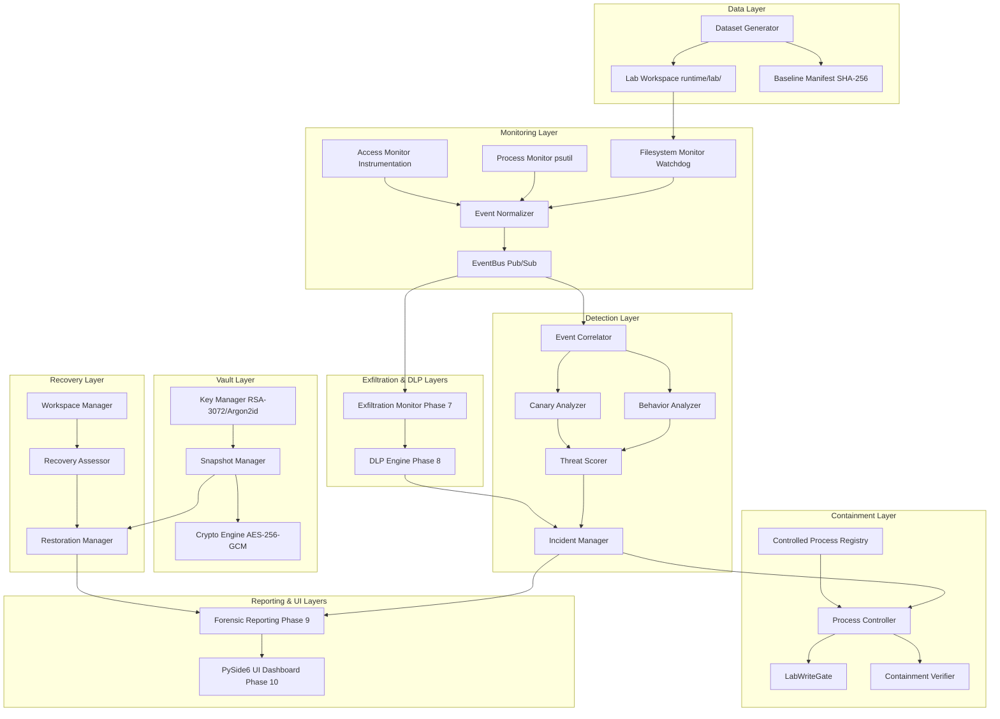

# CryptoShield — Architecture & Subsystem Specification

## 1. High-Level Architectural Flow

---

## 2. Core Infrastructure (`app/core/`)

### 2.1 Thread-Safe Pub/Sub `EventBus` (`app/core/event_bus.py`)
- **Instance:** Singleton `BUS = EventBus()` exported at module level.
- **Concurrency:** Synchronized via `threading.RLock`.
- **Event Dataclass (`Event`):**
  - `event_type`: Strongly typed string token.
  - `data`: Dict of arbitrary payload data.
  - `source`: Identifier string (e.g., `"monitoring"`, `"detection"`, `"recovery"`).
  - `timestamp`: ISO-8601 Indian Standard Time (IST, UTC+05:30) timestamp.
- **Active Event Type Tokens:**
  - Filesystem: `FILE_CREATED`, `FILE_MODIFIED`, `FILE_DELETED`, `FILE_MOVED`, `DIR_CREATED`, `DIR_DELETED`, `DIR_MOVED`
  - Access / Canary: `FILE_READ`, `FILE_OPEN`, `FILE_ACCESS`, `CANARY_ACCESS`
  - Process: `PROCESS_STARTED`, `PROCESS_EXITED`
  - Detection: `DETECTION_RESULT`, `CANARY_SECURITY_ALERT`
  - Incidents: `SECURITY_INCIDENT_CREATED`, `SECURITY_INCIDENT_UPDATED`, `SECURITY_INCIDENT_RESOLVED`
  - Containment: `CONTAINMENT_REQUESTED`, `CONTAINMENT_RECOMMENDED`, `CONTAINMENT_COMPLETED`, `CONTAINMENT_FAILED`, `CONTAINMENT_SKIPPED`
  - Recovery: `RECOVERY_ASSESSMENT_COMPLETED`, `RECOVERY_COMPLETED`, `CANARY_FILE_RESTORED`

### 2.2 Safety & Boundary Engine (`app/core/safety.py`)
- **Marker Validation:** Validates HMAC-SHA256 authenticated `.cryptoshield_lab_marker` and `.cryptoshield_recovery_marker`.
- **Path Traversal Protection:** Canonicalizes paths using `Path.resolve().relative_to(base_dir)`. Rejects any traversal outside registered lab or workspace boundaries.
- **Symlink Escape Protection:** Inspects directory links to ensure operations cannot escape via symbolic links.
- **Process Protection:** Rejects containment of system PIDs (0, 4) or CryptoShield's own parent/runtime process.

---

## 3. Subsystem Specifications

### 3.1 Monitoring Subsystem (`app/monitoring/`)
- `FilesystemMonitor`: Uses `watchdog` to capture OS filesystem events in `runtime/lab/`.
- `ProcessMonitor`: Uses `psutil` to inspect process table changes and query process metadata.
- `AccessMonitor`: Controlled active instrumentation recording file reads and opens. Immediately flags honeypot access as high-priority `CANARY_ACCESS` events.
- `EventNormalizer`: Normalizes raw events into `MonitoringEvent` dataclasses and enriches them with classification, department, and size from `baseline_manifest.json` without secondary disk hashing.

### 3.2 Detection & Incident Subsystem (`app/detection/`)
- `BehaviorAnalyzer`: Analyzes modification bursts, rename frequency, deletion counts, multi-department access patterns, and suspicious file extension spreads across configurable sliding windows (1s, 5s, 10s, 30s).
- `CanaryAnalyzer`: Tracks honeypot interactions. Canary access contributes +50 on first access, +15 on subsequent accesses; canary tampering/deletion scores +60.
- `ThreatScorer`: Combines behavior and canary telemetry into an aggregate 0–100 threat score (`NORMAL`, `LOW`, `MEDIUM`, `HIGH`, `CRITICAL`).
- `IncidentManager`: Maintains stateful incident lifecycles (`INC-<8-hex>.json`), logs chronological progression, and persists dossiers to `runtime/incidents/`.

### 3.3 Containment Subsystem (`app/containment/`)
- `ControlledProcessRegistry`: Registers controlled simulator processes with PID, creation start-time, and executable identity to protect against PID reuse vulnerabilities.
- `LabWriteGate`: Application-level gate writing `.write_gate_state`. Cooperatively checked by controlled simulators before every write.
- `ProcessController`: Executes cooperative termination followed by owned-handle termination for registered simulator processes. Arbitrary process killing is strictly prohibited.
- `ContainmentVerifier`: Audits process exit, write gate closure, and rejection of post-containment write attempts.

### 3.4 Cryptographic Vault Subsystem (`app/vault/`)
- `KeyManager`: Manages RSA-3072 key pairs. Private keys are encrypted in an Argon2id-AES256GCM envelope (Version 2) with 64 KiB memory cost, 3 iterations, and 4 lanes.
- `CryptoEngine`: Streams file encryption using AES-256-GCM in 1 MiB chunks with a 96-bit random nonce and 128-bit tag. Output container is `.cso` (CryptoShield Object, 34-byte header: `CSO1` magic, version, nonce, tag, followed by ciphertext).
- `SnapshotManager`: Compiles AES-256-GCM encrypted snapshots with RSA-OAEP session key wrapping and tamper-evident encrypted manifest catalogs.
- `VaultVerifier`: Cryptographically validates `.cso` containers, object IDs, and tags against the encrypted snapshot manifest.

### 3.5 Recovery Subsystem (`app/recovery/`)
- `RecoveryWorkspaceManager`: Proposes, creates, and seeds isolated recovery workspaces (`runtime/recovery/workspaces/<ws_id>/`). Embeds HMAC-SHA256 recovery markers and guarantees deceptive canary seeding.
- `RecoveryAssessor`: Parallel multi-threaded auditor comparing on-disk files against the snapshot manifest, classifying files as `INTACT`, `MODIFIED`, `MISSING`, `UNREADABLE`, or `UNTRACKED`.
- `RestorationManager`: Two-stage authenticated restore. Decrypts to temporary staging, validates GCM auth tags and SHA-256 digests, quarantines modified evidence, and atomically commits restored files.
- `RecoveryCoordinator`: Coordinates assessment, preview, restoration, and verification flows. Emits audit telemetry to `EventBus`.

### 3.6 Data Exfiltration Monitoring Subsystem (`app/exfiltration/`)
- `MockReceiver`: Safe loopback TCP endpoint (`127.0.0.1`) with ephemeral port binding, in-memory consumption, and local pipe transport fallback.
- `ReadBurstDetector`: Sliding-window analyzer monitoring `FILE_READ`, `FILE_OPEN`, and `CANARY_ACCESS` events, detecting multi-department harvesting bursts and honeypot canary breaches.
- `StagingDetector`: Subscribes to filesystem events to detect directory aggregation and archive staging creations (`.zip`, `.tar`, `.7z`).
- `TransferMonitor`: Enforces loopback safety boundaries, measures throughput metrics, and logs outbound transmission attempts.
- `ExfiltrationCorrelator`: Multi-modal scoring engine fusing read telemetry, canary breach alerts, staging observations, and mock socket transfers into a consolidated 0–100 threat assessment (`LOW`, `MEDIUM`, `HIGH`, `CRITICAL`).
- `ExfiltrationCoordinator`: Central lifecycle coordinator and `IncidentManager` correlation bridge.

### 3.7 Data Loss Prevention (DLP) Subsystem (`app/dlp/`)
- `DLPPolicyEngine`: Priority-ordered rule matrix evaluator assessing transfer classifications, canary honeypots, departments, bulk volume limits, and process identities across four posture profiles (`DEFAULT`, `STRICT`, `AUDIT_ONLY`, `PERMISSIVE`).
- `DLPTransferGate`: Active pre-transmission interception gate that halts forbidden transfers before physical socket delivery, enforcing zero-bytes leakage.
- `DLPApprovalManager`: Quarantines transfers evaluated as `REQUIRE_APPROVAL`, tracks unique `APR-<hex>` authorization tokens, and manages administrative approval/rejection workflows.
- `DLPAuditLogger`: Thread-safe, append-only logger persisting structured JSONL audit records to `runtime/dlp/audit.log`.
- `DLPCoordinator`: Subsystem orchestrator hooking `DLPTransferGate` into `TransferMonitor`, handling profile transitions, and enriching active `SecurityIncident` dossiers with DLP enforcement metrics and chronological timeline records.

### 3.8 Forensic Incident Reporting Subsystem (`app/reporting/`)
- `ForensicAggregator`: Synthesizes multi-domain telemetry from `IncidentManager`, `ContainmentManager`, `RecoveryReporter`, `DLPAuditLogger`, `ExfiltrationCoordinator`, and `BaselineManifest`. Merges multi-subsystem timelines into strict microsecond-order chronological sequences and calculates academic evaluation metrics (detection latency, containment duration, recovery duration, protection rate, and zero-byte leakage verification).
- `ReportExporter`: Renders and exports `ForensicDossier` into 4 presentation formats (structured machine-readable JSON, comprehensive Markdown report, tabular CSV event audit, and responsive dark-theme HTML report).
- `ChainOfCustodyRecord`: Cryptographic chain of custody embedding baseline manifest SHA-256 digests and computing deterministic `dossier_sha256` seals.
- `ForensicCoordinator`: Central singleton coordinator indexing reports under `runtime/reports/`, managing retrieval, verifying cryptographic integrity seals, and subscribing to EventBus `SECURITY_INCIDENT_RESOLVED` events for automatic dossier compilation.

### 3.9 PySide6 Desktop User Interface Subsystem (`app/ui/`)
- `EventBusBridge`: Thread-safe bridge mapping asynchronous background `EventBus` notifications from Watchdog, psutil, DLP, and detection engines directly into queued Qt Signals (`event_received`, `threat_updated`, `incident_created`, `containment_triggered`, `write_gate_changed`, `dlp_interception`, `log_emitted`), ensuring lock-free GUI rendering on the main thread.
- `AsyncWorker`: Generic non-blocking `QThread` execution engine executing intensive cryptographic operations, dataset synthesis, and attack simulations with responsive progress bars and background exception handling.
- `SOC Dark Theme`: Professional cybersecurity operations center visual design system featuring slate backgrounds (`#0b0f19`, `#131b2e`), high-contrast typography, and semantic status color accents (Green, Cyan, Amber, Orange, Red, Purple).
- `CryptoShieldMainWindow`: Integrated operator console uniting all 9 defensive subsystems across an operational status ribbon and 8 dedicated subsystem tabs:
  1. **Dashboard & Telemetry**: Threat score meter, active incident alert card, real-time filtered event log, canary status.
  2. **Lab & Dataset Engine**: Workspace validation, 1k/10k/20k synthetic dataset synthesizer, parallel SHA-256 integrity auditor.
  3. **Threat Containment**: Emergency `LabWriteGate` toggle, controlled process registry auditor, containment operation dossiers.
  4. **Cryptographic Vault**: RSA-3072 key manager, Argon2id envelope verification, AES-256-GCM snapshot creation & cryptographic auditor.
  5. **Recovery & Restoration**: Isolated workspace manager, multithreaded damage assessor, two-stage authenticated restore wizard with evidence quarantine.
  6. **Exfiltration & DLP**: Safe loopback mock receiver controls (`127.0.0.1`), active posture profile selector, rule priority matrix, quarantined approval queue.
  7. **Forensic Reports**: Report dossier catalog, SHA-256 chain-of-custody seal auditor, chronological attack timeline, academic KPI scorecard.
  8. **Simulation Testbed**: One-click execution launcher for all 5 controlled double-extortion scenarios with live terminal audit.
- `CLI Integration`: Executable via `python -m app.main gui [--offscreen]` with seamless headless verification support.
